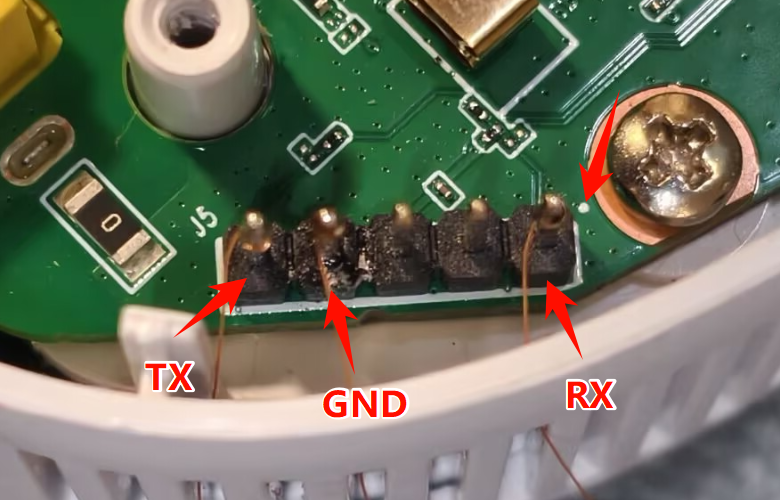

# W1701K 刷机教程

本教程用于通过 TTL 串口给 Gemtek / Quantum Fiber W1701K 刷入 ImmortalWrt / OpenWrt UBI 布局固件。W1701K 原厂 U-Boot 只能直接启动签名镜像，因此需要先写入 U-Boot Chainloader，再通过 UBI Installer 完成分区迁移和系统安装。

相关来源：

* W1701K 支持提交：[ZqinKing/immortalwrt@d4561d9](https://github.com/ZqinKing/immortalwrt/commit/d4561d9ada9227155797e7ba083482b60ead3dd2)
* W1701K Installer 发布页：[ZqinKing/w1700k-ubi-installer/releases/tag/w1701k](https://github.com/ZqinKing/w1700k-ubi-installer/releases/tag/w1701k)
* 后续升级固件：[ZqinKing/wrt_release/releases](https://github.com/ZqinKing/wrt_release/releases)

## 准备工作

在开始刷机之前，请准备以下物品和文件：

* **W1701K 路由器**：待刷机设备。
* **USB 转 TTL 模块**：用于连接路由器串口，电平请选择 3.3V。
* **杜邦线或漆包线**：用于连接 TTL 模块和路由器主板串口。
* **电脑**：Windows、macOS 或 Linux 均可。
* **串口终端软件**：例如 PuTTY、SecureCRT、minicom、screen 或 Serial，波特率 `115200`。
* **TFTP 服务端或客户端**：第一阶段需要 U-Boot 从电脑拉取 chainloader；第二阶段可通过 Chainloader 菜单拉取 installer，也可按原厂 U-Boot 的方式推送 `tcboot.bin`。
* **Chainloader 文件**：从发布页下载 `immortalwrt-airoha-an7581-gemtek_w1701k-ubi-chainload-uboot.itb`。
* **UBI Installer 文件**：从发布页下载 `immortalwrt-airoha-an7581-gemtek_w1701k-ubi-initramfs-installer.itb`。

## TTL 连接

1. **拆机并识别 TTL 接口**：标签二维码下方有一颗 Torx T10 螺丝。拆下后从背部网口附近开始撬开灰白外壳卡扣，在主板上找到 TTL 接口。

   

2. **连接杜邦线**：
   * TTL 模块的 GND 连接路由器 GND。
   * TTL 模块的 RX 连接路由器 TX。
   * TTL 模块的 TX 连接路由器 RX。
   * 不要连接 VCC，避免供电冲突。
   * W1701K 背部有交流电插脚，建议使用漆包线将 TTL 引出机身外，方便恢复后盖。
3. **打开串口终端**：配置正确串口号，波特率 `115200`，数据位 `8`，停止位 `1`，无校验。
4. **上电打断 U-Boot**：给路由器上电，看到启动日志后迅速按任意键进入原厂 U-Boot 命令行。

## 刷机步骤

### 1. 写入 U-Boot Chainloader

1. **配置电脑网络和 TFTP 服务端**：将电脑有线网卡 IP 设置为 `192.168.1.10`，子网掩码 `255.255.255.0`。将 chainloader 文件放到 TFTP 服务目录。
2. **在原厂 U-Boot 中设置网络并拉取 chainloader**：

   ```bash
   setenv serverip 192.168.1.10
   setenv ipaddr 192.168.1.1
   tftpboot 0x89000000 immortalwrt-airoha-an7581-gemtek_w1701k-ubi-chainload-uboot.itb
   ```

   原厂以太网驱动不稳定，`tftpboot` 如果超时或失败，可以断电重启后重新打断 U-Boot 再试几次。

3. **修改启动命令，让原厂 U-Boot 启动 chainloader 分区**：

   ```bash
   setenv one flash read 0x600000 0x1000000 $loadaddr
   setenv two "; bootm"
   setenv bootcmd "$one$two"
   setenv one
   setenv two
   saveenv
   ```

4. **擦写 chainloader 分区并重启**：确认上一步 `tftpboot` 已成功后，再执行以下命令。

   ```bash
   flash erase 0x600000 0x100000
   flash write 0x600000 0x100000 0x89000000
   reset
   ```

   重启后，原厂 U-Boot 会从 `0x600000` 读取并启动新写入的 U-Boot Chainloader。

### 2. 运行 UBI Installer

推荐使用 Chainloader 自带的启动菜单加载 installer。

1. **配置电脑 TFTP 服务端**：将电脑有线网卡 IP 设置为 `192.168.1.2`，子网掩码 `255.255.255.0`。将 installer 文件放到 TFTP 服务目录，文件名保持为：

   ```text
   immortalwrt-airoha-an7581-gemtek_w1701k-ubi-initramfs-installer.itb
   ```

2. **进入 Chainloader 菜单**：路由器重启到 U-Boot Chainloader 后，串口会出现启动菜单。
3. **选择 installer 启动项**：选择 `Boot installer via TFTP.`，Chainloader 会自动从 `192.168.1.2` 下载 installer 并启动。

   ```text
   *** U-Boot Boot Menu ***

       1. Run default boot command.
       2. Boot system via TFTP.
       3. Boot recovery system from flash.
       4. Boot installer via TFTP.
       5. Reboot.
       0. Exit
   ```

4. **等待安装完成**：installer 会自动完成 UBI 布局迁移并安装初始系统。如果提示检测到已有 UBI 布局并询问是否覆盖，输入 `yes` 会重新格式化并覆盖原有系统。

### 3. 备用方式：通过原厂 U-Boot 推送 installer

如果无法使用 Chainloader 菜单，也可以按提交说明使用原厂 U-Boot 的 TFTP push 流程：

1. 将 installer 文件重命名为 `tcboot.bin`。
2. 重新上电并打断原厂 U-Boot。
3. 在 U-Boot 中设置加载地址：

   ```bash
   setenv loadaddr 0x89000000
   ```

4. 在电脑端使用 TFTP 客户端将 `tcboot.bin` 推送到 `192.168.1.1`。

   ```bash
   tftp -i 192.168.1.1 put tcboot.bin
   ```

5. 推送完成后，在 U-Boot 中启动 installer：

   ```bash
   bootm 0x89000000
   ```

### 4. 后续升级固件

installer 完成后，设备会进入可持久化的 UBI 布局系统。后续升级请使用 W1701K UBI sysupgrade 固件，例如：

```text
immortalwrt-airoha-an7581-gemtek_w1701k-ubi-squashfs-sysupgrade.itb
```

可在 [ZqinKing/wrt_release/releases](https://github.com/ZqinKing/wrt_release/releases) 下载对应 W1701K 的发布版本。进入 LuCI 后，通过“系统” -> “备份/刷写固件”上传并刷写 `sysupgrade.itb` 文件即可。

## 注意事项

* 本教程会修改启动环境变量并擦写 `0x600000` 处的 chainloader 分区，请确认文件下载完整且设备型号为 W1701K。
* W1701K 使用 `gemtek_w1701k-ubi` 设备名，不要混用 W1700K、XR1710G 或其他 AN7581 设备的 chainloader / installer。
* 第一阶段 U-Boot 拉取 chainloader 时，电脑 IP 通常为 `192.168.1.10`；进入 Chainloader 菜单后，默认 TFTP 服务端 IP 为 `192.168.1.2`。
* 原厂 U-Boot 的网口驱动可能不稳定，TFTP 失败时优先重启设备并重试。
* 不要连接 TTL 模块的 VCC；只连接 GND、TX、RX。
* 如果刷机中断或无法启动，请重新进入串口确认当前处于原厂 U-Boot、U-Boot Chainloader 还是 installer，再选择对应步骤继续。
